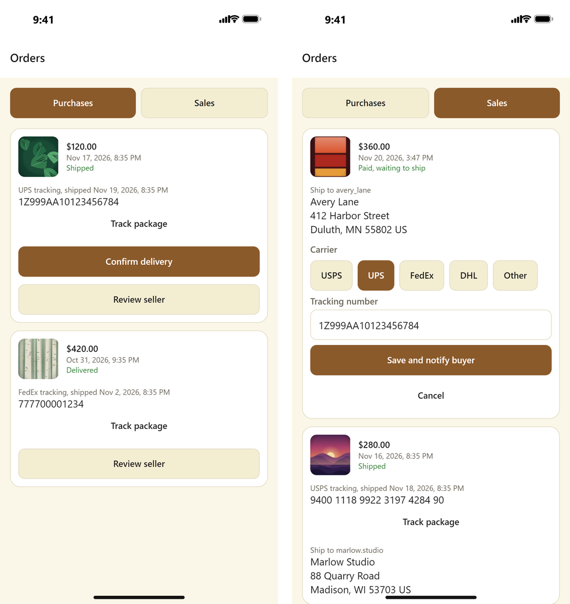

# FrameOn

A marketplace for sharing and selling artwork: post photos, rate and comment on work, follow artists, and buy
pieces through Stripe. Expo (React Native) rebuild of the original Swift app.

## Setup

```bash
npm install
cp .env.example .env.local   # fill in the Firebase web config (Firebase console > Project settings > Your apps)
npx expo start
```

Stripe's native SDK is not in Expo Go, so payments need a development build (`eas build --profile development`).

Crash reporting is optional: it stays off unless `EXPO_PUBLIC_SENTRY_DSN` is set for a build (see [docs/operations.md](docs/operations.md)).

## Scripts

| Command             | What it does                  |
| ------------------- | ----------------------------- |
| `npm run check`     | lint, typecheck and tests     |
| `npm run lint`      | ESLint                        |
| `npm run typecheck` | `tsc --noEmit`                |
| `npm test`          | Jest                          |
| `npm run test:rules` | Firestore and Storage rules against the emulators (needs Java) |
| `npm run test:functions` | Stripe webhook, order and counter tests against the Firestore emulator (needs Java) |
| `npm run test:ops` | Tests for the operations scripts and the deploy compatibility guard |
| `npm run check:compat` | Fails if the backend would write order statuses or notification types the supported app cannot read (run after building the functions) |

## Orders

After a purchase the seller marks the order shipped with a carrier and tracking number, the buyer is notified and can track the package and confirm delivery, and shipped orders count as delivered after 14 days if the buyer never confirms. Refunds put an unshipped piece back in stock and take away the buyer's right to review that seller; Stripe disputes flag the order and alert the developer. The rules for which change is allowed live in one tested function (`functions/src/orderLogic.ts`); see [docs/data-model.md](docs/data-model.md) for the order fields and [docs/release-checklist.md](docs/release-checklist.md) for the deploy order.



## Operations

How the live backend is watched, recovered and deployed is in [docs/operations.md](docs/operations.md):

- **Alerts and recovery.** `scripts/ops/setup-alerts.mjs` sets up email alerts for payment-webhook, order and other function errors, a monthly budget, Firestore point-in-time recovery and a daily backup. It prints what it would do unless `--apply` is given.
- **Crash reporting.** The app reports crashes and unexpected errors to Sentry (anonymous account id only), once a DSN is set at build time. It needs a store build.
- **Deploying.** The backend deploys from the **Deploy backend** GitHub Actions workflow: CI on the commit, an approval, then Firebase deploy with keyless Google Cloud sign-in. `compat/app-contract.json` records what the oldest supported app understands, and the workflow refuses to deploy a backend that writes anything else, so the app always ships first.
- Rating, comment and seller-review counters are recounted from the documents rather than incremented, so a retried event cannot make them drift.

## Growth

Posts and profiles can be shared from the app (plain text and a link, no image), the website has a landing page, and store links carry campaign tags so installs can be told apart in App Store Connect. See [docs/growth.md](docs/growth.md).

## Layout

- `src/app` routes (expo-router); `(auth)` when signed out, `(tabs)` when signed in
- `src/components/ui` design-system components
- `src/constants/theme.ts` design tokens (light and dark)
- `scripts/ops`, `compat`, `.github/workflows` alert setup, the deploy compatibility contract and CI/deploy
- `src/lib` Firebase setup, auth state, formatting and validation
